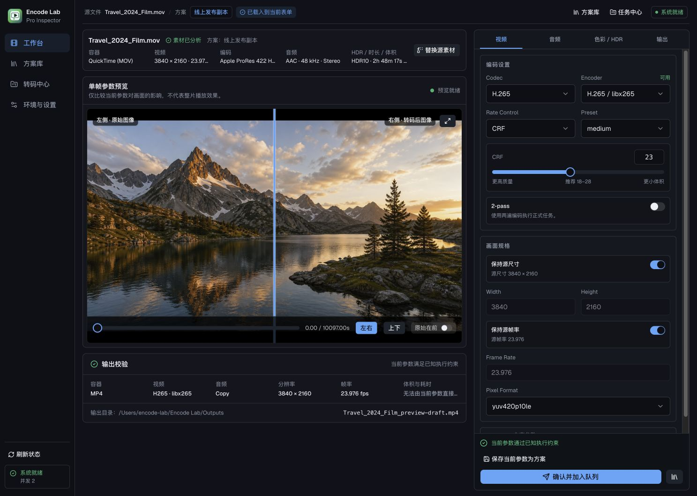

<p align="center">
  
</p>

<h1 align="center">Encode Lab</h1>

<p align="center">
  A local-first desktop workbench for evidence-driven video transcoding.
</p>

<p align="center">
  Configure with guardrails, compare actual encoded frames, then send verified jobs to a recoverable FFmpeg queue.
</p>

<p align="center">
  <a href="https://github.com/iGmainC/encode-lab/actions/workflows/ci.yml"></a>
  <a href="https://github.com/iGmainC/encode-lab/releases/latest"></a>
  <a href="./LICENSE"></a>
  
  
</p>

<p align="center">
  <strong>English</strong> · <a href="./README.zh-CN.md">简体中文</a> ·
  <a href="https://github.com/iGmainC/encode-lab/releases/latest">Download</a> ·
  <a href="./CONTRIBUTING.md">Contributing</a>
</p>

> [!IMPORTANT]
> Encode Lab is beta software. Keep the source media until you have inspected the output, and test important workflows on short clips before processing irreplaceable footage.



## Why Encode Lab?

Most FFmpeg frontends stop at exposing parameters. Encode Lab focuses on the decision that comes before a long transcode:

1. Understand the source and the capabilities of the current machine.
2. Configure an output with codec, container, audio, HDR, and stream-preservation guardrails.
3. Encode a real frame and compare it with the source instead of showing a cosmetic filter preview.
4. Review deterministic output facts before queueing.
5. Observe, cancel, recover, and inspect the result from one local workflow.

The application runs locally. Source paths, task history, templates, preview frames, and command output are not uploaded to a hosted Encode Lab service.

## Highlights

- **One professional workbench** — source inspection, video/audio/HDR controls, frame comparison, output validation, and queueing stay in one context.
- **Evidence before execution** — the preview path encodes a single frame with the selected parameters, decodes it, and presents a source/output split comparison.
- **Capability-aware configuration** — available encoders and incompatible combinations are derived from the detected runtime rather than presented as promises.
- **Recoverable local queue** — FIFO scheduling, configurable concurrency, progress metrics, cancellation, interrupted-job recovery, and atomic final-output publication.
- **Dolby Vision-aware boundaries** — dedicated RPU-preservation routes validate the source, container, streams, output metadata, frame counts, and per-frame RPU semantics before publication.
- **Deterministic runtime** — official builds bundle a checksummed FFmpeg/FFprobe, x265 CLI, and dovi_tool runtime for supported platforms, with a system-runtime fallback for development.
- **Local reusable plans** — save parameter snapshots without binding them to one source file or output directory.
- **Light and dark themes** with Simplified Chinese and English UI.

## Supported platforms

| Platform | Official release target | Bundled runtime | Notes |
| --- | --- | --- | --- |
| macOS 15+ on Apple Silicon | Yes | Yes | Ad-hoc signed unless a notarized build is explicitly announced. |
| Linux x86_64, glibc 2.35+ | Yes | Yes | AppImage, Debian, and RPM bundles are produced by the release workflow. |
| Windows | Not in the current release matrix | No | Source-level portability remains, but Windows is not currently a supported binary target. |
| Intel macOS | Not in the current release matrix | No | The current runtime baseline is Apple Silicon. |

Installers, updater signatures, and a `SHA256SUMS` manifest are published on the [GitHub Releases page](https://github.com/iGmainC/encode-lab/releases/latest).

### macOS first launch

Current community builds use an ad-hoc signature and are not notarized. macOS may therefore require an explicit approval from **System Settings → Privacy & Security** after the first launch.

### Linux AppImage

```bash
chmod +x ./<downloaded-file>.AppImage
./<downloaded-file>.AppImage
```

## Dolby Vision scope

Encode Lab does not claim that every Dolby Vision source can be safely re-encoded.

The current dedicated preservation pipeline is intentionally narrow:

- single-layer Profile 5 / compatibility ID 0, or Profile 8 / compatibility ID 1;
- base layer plus RPU, with no enhancement layer;
- 10-bit constant-frame-rate HEVC;
- no crop, resize, frame-rate conversion, trimming, or two-pass encode;
- MKV for full-stream archival semantics;
- MP4 only for the validated Profile 8.1 route and compatible copied audio, without subtitles, attachments, data streams, TrueHD, DTS, or PCM.

Unsupported combinations are rejected before queueing. The complete checkout-specific policy is documented in [the V1 specification](./docs/ffmpeg-v1-%E5%8A%9F%E8%83%BD%E8%A7%84%E6%A0%BC.md).

## Development

### Prerequisites

- [Bun](https://bun.sh/) matching the version declared in `package.json`
- current stable [Rust](https://www.rust-lang.org/tools/install)
- platform build dependencies required by [Tauri 2](https://v2.tauri.app/start/prerequisites/)
- internet access on the first desktop build to download the checksummed Encode Lab FFmpeg runtime

### Start the desktop app

```bash
git clone https://github.com/iGmainC/encode-lab.git
cd encode-lab
bun install --frozen-lockfile
bun run tauri dev
```

The browser-only development server is also useful for UI work:

```bash
bun run dev -- --host localhost
```

Browser mode uses clearly marked example data and does not expose desktop-only writes, native window management, or real queue execution.

### Validate a change

```bash
bun run check
cargo fmt --manifest-path src-tauri/Cargo.toml -- --check
cargo test --manifest-path src-tauri/Cargo.toml
```

GitHub Actions repeats the frontend checks and Rust tests on pull requests and pushes to `main`.

## Architecture

```text
React + TypeScript
  ├─ workbench and validation policy
  ├─ frame comparison and local UI state
  └─ Tauri command/event boundary
               │
Rust + Tauri
  ├─ media probing and capability detection
  ├─ preview process lifecycle
  ├─ command and preservation-plan construction
  ├─ FIFO job manager and crash recovery
  └─ atomic JSON repositories
               │
Bundled command-line runtime
  └─ FFmpeg · FFprobe · x265 · dovi_tool
```

Persistent application data is stored under the platform application-data directory. Disposable preview frames, evaluation logs, pass logs, partial outputs, and multistage workspaces are placed under the system temporary directory and are actively reclaimed.

## Release process

Releases are built from SemVer tags matching `vX.Y.Z` or `vX.Y.Z-beta`.

```bash
bun run release:version -- v0.1.0-beta
git tag -s v0.1.0-beta -m "Encode Lab v0.1.0-beta"
git push origin v0.1.0-beta
```

The release workflow verifies that the tag belongs to `main`, runs the quality gate, builds the supported native bundles, signs updater artifacts, generates release notes, and verifies `latest.json`, signatures, and anonymous asset downloads. Maintainer setup and rollback instructions live in [docs/releasing.md](./docs/releasing.md).

## Project documentation

- [Product flow and module boundaries](./docs/%E4%BA%A7%E5%93%81%E4%B8%9A%E5%8A%A1%E9%80%BB%E8%BE%91%E4%B8%8E%E5%8A%9F%E8%83%BD%E6%A8%A1%E5%9D%97%E8%B0%83%E6%95%B4.md)
- [V1 product and technical specification](./docs/ffmpeg-v1-%E5%8A%9F%E8%83%BD%E8%A7%84%E6%A0%BC.md)
- [Development roadmap and acceptance checklist](./docs/development-roadmap.md)
- [Distributed transcoding exploration](./docs/%E8%8A%82%E7%82%B9%E6%8B%93%E5%B1%95%E4%B8%8E%E5%88%86%E5%B8%83%E5%BC%8F%E8%BD%AC%E7%A0%81%E8%AE%BE%E8%AE%A1.md)

## Contributing and security

Issues and pull requests are welcome. Start with [CONTRIBUTING.md](./CONTRIBUTING.md), and use GitHub's private vulnerability reporting flow described in [SECURITY.md](./SECURITY.md) for security-sensitive reports.

Please do not upload private source media, full local paths, signing keys, or unredacted FFmpeg logs to public issues.

## License

Encode Lab source code is available under the [MIT License](./LICENSE).

Official application bundles include separately licensed command-line tools. In particular, the bundled FFmpeg runtime enables GPL components. See [THIRD_PARTY_NOTICES.md](./THIRD_PARTY_NOTICES.md) and the reproducible [encode-lab-ffmpeg](https://github.com/iGmainC/encode-lab-ffmpeg) build repository for the applicable terms and source references.
